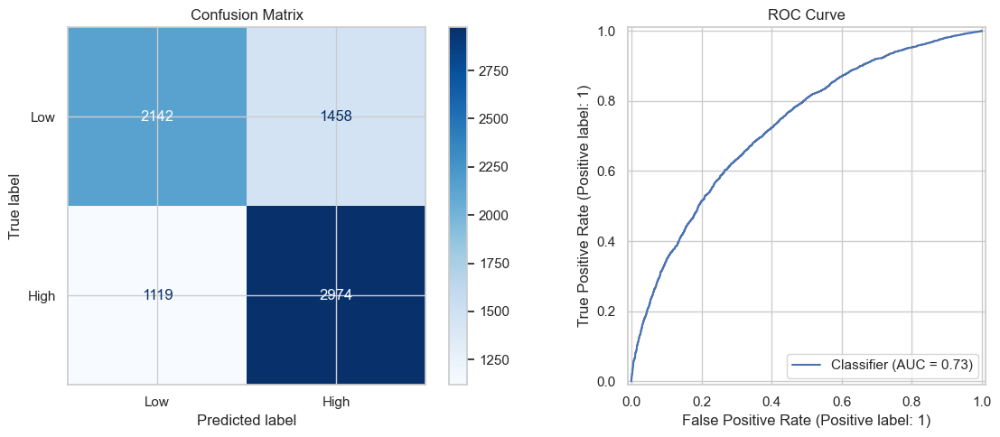
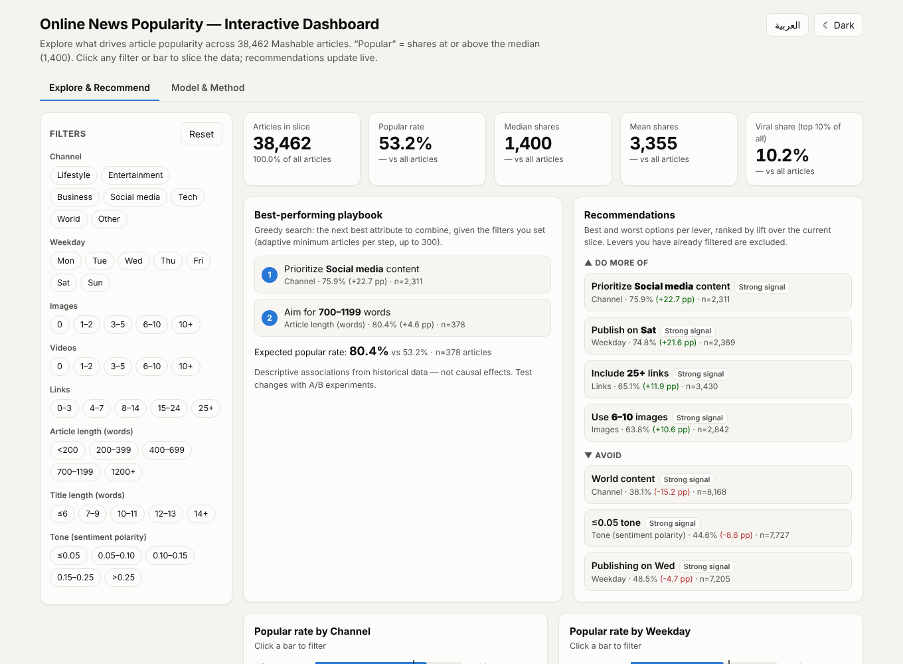
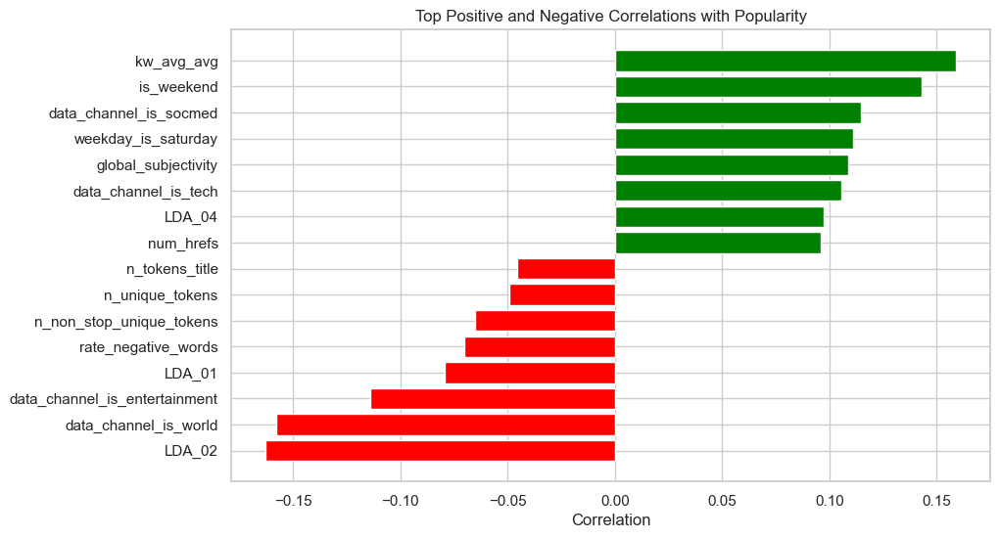

# 📰 شعبية الأخبار الإلكترونية — أي الأخبار ستنتشر؟

[English](README.md) · **العربية**

<div dir="rtl">

تصنيف ثنائي لمقالات Mashable إلى **شعبية عالية (High)** و**شعبية منخفضة (Low)** اعتماداً على محتوى المقال وبياناته الوصفية ووقت نشره. يغطي المشروع دورة علم البيانات كاملة: الاستكشاف ← التنظيف ← تحليل العوامل ← اختيار الخصائص ← النمذجة ← التقييم ← حفظ النموذج.

## النتائج

</div>

| النموذج | الدقة (Accuracy) | Precision (High) | Recall (High) | F1 (High) | ROC AUC |
|---|---|---|---|---|---|
| خط الأساس (الفئة الأكثر تكراراً) | 0.532 | 0.532 | 1.000 | 0.695 | 0.500 |
| الانحدار اللوجستي | 0.641 | 0.654 | 0.691 | 0.672 | 0.694 |
| **الغابة العشوائية (Random Forest)** | **0.665** | **0.671** | **0.727** | **0.698** | **0.729** |

<div dir="rtl">

- التحقق المتقاطع (5 طيات) للغابة العشوائية: دقة **0.663 ± 0.007**، وهي متسقة مع دقة الاختبار 0.665.
- الغابة العشوائية تتفوق على خط الأساس بنحو **13 نقطة مئوية**.

</div>



<div dir="rtl">

## اللوحة التفاعلية

لوحة HTML مستقلة وثنائية اللغة (إنجليزي / عربي) مبنية من البيانات والنموذج نفسيهما:
فلترة حسب القناة ويوم النشر والصور والفيديوهات والروابط وطول المقال وطول العنوان والنبرة، ومؤشرات KPI تتحدّث مباشرة،
و**توصيات مبنية على البيانات** و**أفضل خطة نشر** للشريحة التي تختارها، ومقارنة بين النماذج.

**الرابط الحي:** https://salehmsa.github.io/online-news-popularity-classification/ &nbsp;·&nbsp; **الملف:** [`docs/index.html`](docs/index.html) (يُفتح مباشرة في أي متصفح دون خادم)

</div>



<div dir="rtl">

## البيانات

[UCI – Online News Popularity](https://archive.ics.uci.edu/dataset/332/online+news+popularity): 39,644 مقالاً من Mashable، و58 خاصية تنبؤية (المحتوى، الكلمات المفتاحية، المواضيع LDA، المشاعر، القناة، يوم النشر) إضافة إلى المتغير `shares`. توجد نسخة في المجلد [`data/`](data/)، كما ينزّلها الدفتر تلقائياً من UCI (وينفّذ الأمر `python scripts/download_data.py` الشيء نفسه).

**المتغير الهدف:** `popular = 1` إذا كان `shares` ≥ الوسيط (1,400)، وإلا `0` ← فئتان متوازنتان (~53٪ / 47٪).

## المنهجية

1. **التحميل والفحص** – تصحيح أسماء الأعمدة (مسافات بادئة مخفية)، وفحص القيم المفقودة والمكررة.
2. **استكشاف الهدف** – توزيع `shares` منحرف بشدة لليمين (المتوسط 3,395 مقابل الوسيط 1,400)، واستُخدم المقياس اللوغاريتمي في التحليل.
3. **التنظيف** – حذف `url` و`timedelta`، وحذف المقالات بلا كلمات والصفوف التي فيها `n_unique_tokens > 1` (1,182 صفاً).
4. **تحليل العوامل** – الارتباطات، والقناة، ويوم النشر، وفئات الصور والفيديوهات والروابط.
5. **التقسيم** – تقسيم طبقي 80/20 بـ `random_state=42` **قبل** اختيار الخصائص لتفادي تسرّب البيانات.
6. **اختيار الخصائص** – المعلومات المتبادلة (Mutual Information) على بيانات التدريب فقط، وأفضل K = 25.
7. **النمذجة** – خط الأساس، والغابة العشوائية (300 شجرة، عمق 15، حد أدنى للورقة 5)، والانحدار اللوجستي (مع التحجيم).
8. **التقييم** – الدقة، وPrecision/Recall/F1، وROC AUC، ومصفوفة الالتباس، وأهمية الخصائص، ونسب الأرجحية، والتحقق المتقاطع.
9. **الحفظ** – حفظ النموذج المدرَّب وقائمة الخصائص المختارة بواسطة `joblib`.

## أهم الاستنتاجات

- خصائص المواضيع (LDA) وأداء الكلمات المفتاحية (`kw_avg_avg`، `kw_max_avg`) تحمل أكبر قدر من الإشارة.
- الشعبية تختلف باختلاف القناة ويوم النشر، والمقالات ذات الصور أو الروابط الأكثر تميل إلى شعبية أعلى.
- هذه **ارتباطات وليست علاقات سببية** — أهمية الخاصية لا تعني أنها تسبّب الشعبية.
- الدقة تتوقف قرب 66٪ لأن عوامل مؤثرة (نص المقال، جودة العنوان، نشاط وسائل التواصل) غير موجودة في البيانات.

</div>



<div dir="rtl">

## الحدود والخطوات القادمة

- إضافة خصائص نصية (TF-IDF / Embeddings) وخصائص للعنوان.
- تجربة Gradient Boosting وضبط المعاملات (`GridSearchCV`).
- تقييم عتبة "الانتشار الواسع" عند أعلى 10٪، حيث تصبح مفاضلة Precision/Recall أهم.
- الأخلاقيات: تحسين المحتوى لزيادة الانتشار المتوقع قد يكافئ عناوين الإثارة (Clickbait) على حساب جودة الصحافة.
- نشر النموذج خلف خدمة FastAPI داخل Docker.

## هيكل المشروع

</div>

```
.
├── docs/index.html                        # اللوحة التفاعلية (GitHub Pages)
├── notebooks/
│   └── News_Popularity_Prediction.ipynb   # التحليل الكامل
├── data/                                  # OnlineNewsPopularity.csv + شرح البيانات
├── scripts/download_data.py               # إعادة تنزيل البيانات من UCI
├── assets/                                # الرسوم المستخدمة في هذا الملف
├── models/                                # النماذج المحفوظة (خارج Git)
├── requirements.txt
├── .gitignore
├── README.md
└── README.ar.md
```

<div dir="rtl">

## التشغيل

</div>

```bash
git clone https://github.com/Salehmsa/online-news-popularity-classification.git
cd online-news-popularity-classification

python -m venv .venv
.venv\Scripts\activate          # ويندوز  (ماك/لينكس: source .venv/bin/activate)
pip install -r requirements.txt

jupyter notebook notebooks/News_Popularity_Prediction.ipynb
```

<div dir="rtl">

شغّل كل الخلايا من الأعلى إلى الأسفل. يكتب الدفتر الملفين `news_popularity_rf.pkl` و`selected_features.pkl` في مجلد العمل (خارج Git).

## التقنيات

Python · Pandas · NumPy · Scikit-learn · Matplotlib · Seaborn · Joblib

## المؤلف

**صالح محبوب** — [GitHub](https://github.com/Salehmsa)

</div>
