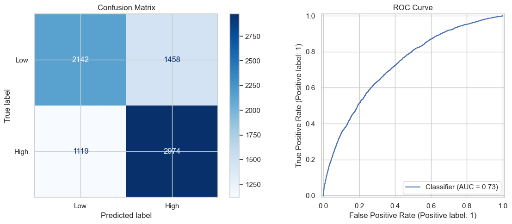
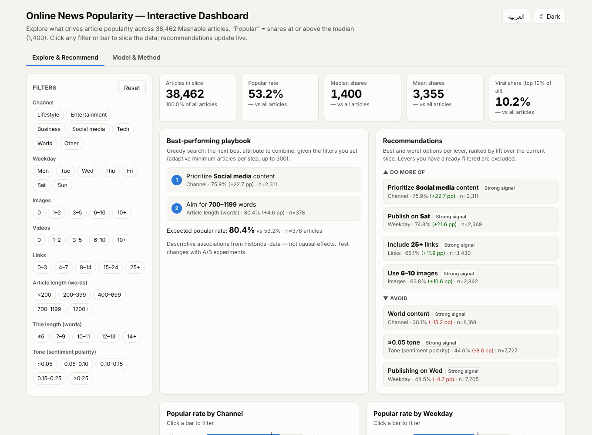
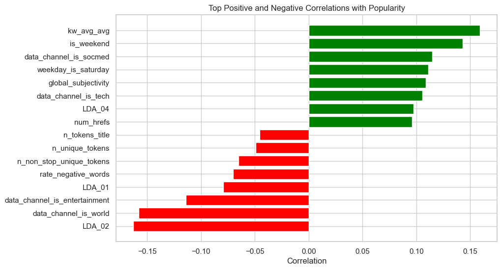

# 📰 Online News Popularity — Which News Will Go Viral?

**English** · [العربية](README.ar.md)

Binary classification of Mashable articles into **High** vs **Low** popularity using article content, metadata, and publishing time. The project covers the full data-science workflow: EDA → cleaning → factor analysis → feature selection → modeling → evaluation → model export.

## Results

| Model | Accuracy | Precision (High) | Recall (High) | F1 (High) | ROC AUC |
|---|---|---|---|---|---|
| Baseline (most frequent) | 0.532 | 0.532 | 1.000 | 0.695 | 0.500 |
| Logistic Regression | 0.641 | 0.654 | 0.691 | 0.672 | 0.694 |
| **Random Forest** | **0.665** | **0.671** | **0.727** | **0.698** | **0.729** |

- 5-fold cross-validation (Random Forest): **0.663 ± 0.007** accuracy, consistent with the 0.665 test score.
- Random Forest beats the majority-class baseline by ~13 percentage points.



## Interactive dashboard
A self-contained, bilingual (English / Arabic) HTML dashboard built from the same data and model:
filter by channel, weekday, images, videos, links, article length, title length and tone; see KPIs update live;
get **data-driven recommendations** and a **best-performing playbook** for the slice you choose; compare the models.

**Live:** https://salehmsa.github.io/online-news-popularity-classification/ &nbsp;·&nbsp; **File:** [`docs/index.html`](docs/index.html) (open it directly in any browser, no server needed)



## Dataset
[UCI – Online News Popularity](https://archive.ics.uci.edu/dataset/332/online+news+popularity): 39,644 Mashable articles, 58 predictive features (content, keywords, topics/LDA, sentiment, channel, weekday) and the target `shares`. A copy lives in [`data/`](data/); the notebook also downloads it from UCI automatically (`python scripts/download_data.py` does the same).

**Target:** `popular = 1` if `shares` ≥ median (1,400), else `0` → balanced classes (~53% / 47%).

## Approach
1. **Load & inspect** – fix column names (hidden leading spaces), check missing values and duplicates.
2. **Target exploration** – `shares` is heavily right-skewed (mean 3,395 vs. median 1,400); log scale used for analysis.
3. **Cleaning** – drop `url` and `timedelta`; remove 0-word articles and rows with `n_unique_tokens > 1` (1,182 rows).
4. **Factor analysis** – correlations, channel, weekday, and images/videos/links buckets.
5. **Split** – stratified 80/20 split, `random_state=42`, *before* feature selection to avoid leakage.
6. **Feature selection** – Mutual Information on the training set only, top K = 25.
7. **Modeling** – Dummy baseline, Random Forest (300 trees, depth 15, min leaf 5), Logistic Regression (scaled).
8. **Evaluation** – accuracy, precision/recall/F1, ROC AUC, confusion matrix, feature importances, odds ratios, cross-validation.
9. **Export** – trained model and selected feature list saved with `joblib`.

## Key findings
- Topic (LDA) and keyword-performance features (`kw_avg_avg`, `kw_max_avg`) carry the most signal.
- Popularity varies by channel and weekday; articles with more images or links tend to be more popular.
- These are **associations, not causal effects** — feature importance ≠ causation.
- Accuracy tops out near 66% because key drivers (article text, headline quality, social-media activity) are not in the data.



## Limitations & next steps
- Add text features (TF-IDF / embeddings) and headline features.
- Try gradient boosting and hyperparameter tuning (`GridSearchCV`).
- Evaluate a top-10% "viral" threshold, where precision/recall trade-offs matter more.
- Ethics: optimizing for predicted virality can reward clickbait over quality journalism.
- Deploy the model behind a FastAPI service with Docker.

## Project structure
```
.
├── docs/index.html                        # interactive dashboard (GitHub Pages)
├── notebooks/
│   └── News_Popularity_Prediction.ipynb   # full analysis
├── data/                                  # OnlineNewsPopularity.csv + data README
├── scripts/download_data.py               # re-download the dataset from UCI
├── assets/                                # figures used in this README
├── models/                                # saved models (git-ignored)
├── requirements.txt
├── .gitignore
└── README.md
```

## Run it
```bash
git clone https://github.com/Salehmsa/online-news-popularity-classification.git
cd online-news-popularity-classification

python -m venv .venv
.venv\Scripts\activate          # Windows  (macOS/Linux: source .venv/bin/activate)
pip install -r requirements.txt

jupyter notebook notebooks/News_Popularity_Prediction.ipynb
```
Run all cells top to bottom. The notebook writes `news_popularity_rf.pkl` and `selected_features.pkl` to the working directory (git-ignored).

## Tech stack
Python · Pandas · NumPy · Scikit-learn · Matplotlib · Seaborn · Joblib

## Author
**Saleh Mahbub** — [GitHub](https://github.com/Salehmsa)
